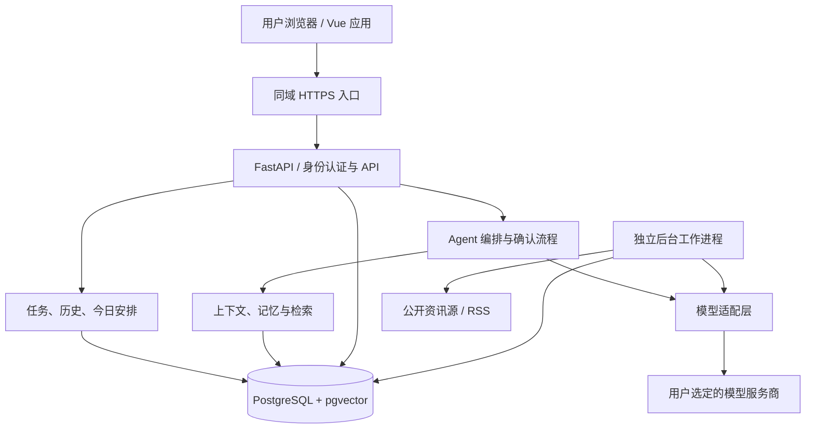
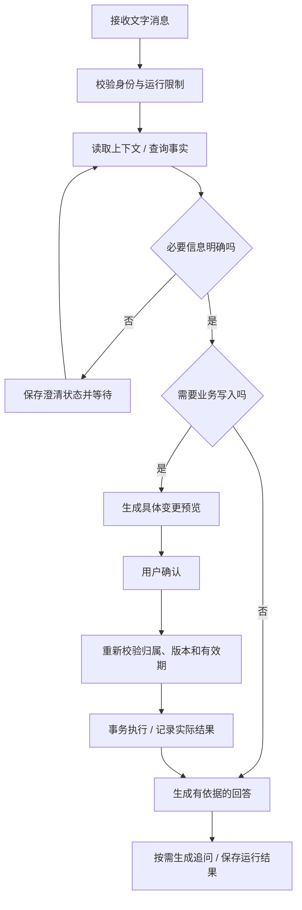

# AI 工作与生活待办清单 2.0 设计方案

日期：2026-10-01

状态：已按用户 2026-10-01 的指示实现 P0–P4 本地开发版；P1 真实双厂商联调及 P4 正式发布出口仍待配置验证。详见 [开发说明](../../V2-DEVELOPMENT.md) 与 [P1–P4 验收](../../P1-P4-ACCEPTANCE.md)。

适用项目：`D:\deepseek\todo-list`

阅读建议：先看第 1 节确认范围，第 4 节查看产品交互，第 7～11 节评审 AI 行为，第 15～16 节查看实施阶段和验收标准。其余章节为后续实现提供技术约束。

## 1. 产品目标与决策状态

产品面向分别注册使用的个人用户，管理工作和生活事项。AI 帮助理解输入、查询历史、拆解任务、提出安排和推荐资讯；用户掌握任务变更和推荐开关。核心清单在没有 API Key 或模型不可用时仍可使用。

### 1.1 用户已明确的需求

| 编号 | 需求 | 设计约束 |
| --- | --- | --- |
| R01 | 保留 1.0，再进行重构 | 保存当前文件及未提交修改；2.0 在独立开发分支实施 |
| R02 | 多用户注册使用，前后端分离 | 后端 Python + FastAPI；每个用户的数据独立 |
| R03 | 同时用于工作和生活 | 工作、生活有独立范围，也可合并查看今日安排 |
| R04 | 移除花田与语音输入 | 2.0 无花田入口、成长逻辑、资源依赖、录音或语音服务配置 |
| R05 | 具备记忆和遗忘机制 | 区分自然衰减、过期、替代、休眠与明确删除 |
| R06 | 查询过去是否做过类似事情 | 保存任务事件与历史快照，提供时间和语义检索、来源证据 |
| R07 | 推荐相关资讯与当天工作 | 两项功能独立开关；工作建议须用户确认才生效 |
| R08 | 提供可点击的后续问题 | 回答结束后按需生成追问，不自动发送或执行 |
| R09 | 不明确的问题先澄清 | 先利用上下文，缺少影响结果的必要信息时等待用户补充 |
| R10 | 每个用户自备不同厂商 API Key | 首批支持 DeepSeek、通义千问／阿里云百炼，多组配置可共存 |
| R11 | 自由选择厂商模型 | 动态获取目录，按账户权限、地域、协议与功能能力验证可用性 |
| R12 | 按问题难度自动切换思考模式 | 自动／快速／深度；适配具体模型能力，不擅自换模型或厂商 |

### 1.2 本方案建议采用的默认规则

以下为可在评审时调整的设计提案，不代表用户逐项指定：

- 前端 Vue 3 + TypeScript + Vite + Vue Router + Pinia，通用组件采用 Element Plus。
- 数据层 PostgreSQL + pgvector，Python 数据访问使用 SQLAlchemy，迁移使用 Alembic。
- 后端采用模块化单体；后台任务为独立工作进程，共用业务代码和数据库。
- AI 对任务的写操作统一生成变更预览，由用户确认；用户直接点击常规任务按钮无需再次确认同一操作。永久删除等不可恢复操作单独明确提示。
- 资讯推荐、今日工作建议的定时生成默认关闭，首次启用时说明调用用户 Key；通知默认关闭，智能追问默认开启且可关闭。
- 首版支持邮箱与密码注册、验证与密码重置；验证邮件需要部署方配置邮件服务，公开部署前必须验证完整流程。
- 不引入团队共享任务、组织权限、支付、外部应用自动操作、独立图数据库或独立向量数据库。

## 2. 现状、1.0 保留与迁移原则

当前为原生 HTML/CSS/JavaScript 单文件应用，业务集中在约 4,900 行的 `index.html`。任务及界面设置保存于浏览器 `localStorage` 的 `my-todo-list-v3`；DeepSeek Key 使用独立的 `dsKey`。AI 从浏览器直连接口，并解析回复中的隐藏标记完成部分操作。

现有功能包括任务与子任务、优先级、日期导航、统计、专注计时、主题、垃圾站、JSON 和 Excel 导出、天气与花田。2.0 将其中任务与数据能力迁到后端，保留手动使用路径，移除花田。天气作为可关闭的辅助组件保留到界面迁移阶段，不参与核心 Agent 决策。

已创建并逐文件校验的 1.0 快照：

- 路径：`D:\deepseek\todo-list-v1.0-20260930-526dbebd.zip`。
- 包含 163 个文件，涵盖 Git 历史、未提交修改和资源。
- SHA-256：`E4F00F9BD7A90E0BEC6617CBDFD70B95E9DCE822DD6C448634684B3774B7BDFB`。
- 该文件属于本地开发快照，可能含开发运行状态，不作为公开发布包。
- 快照不包含浏览器中的任务数据；用户仍需从 1.0 导出 JSON。默认导出主要包含任务，不承诺包含垃圾站、设置或完整历史。

实施开始时创建 `codex/ai-todo-v2` 分支，继续保留此快照。当前工作区的已有未提交修改不得被清理或混入无关提交。旧根目录入口在新应用验收前保留；新代码放入 `frontend/`、`backend/`，后续切换发布入口。使用只支持静态页面的原部署方式无法运行 FastAPI，部署需同步升级。

## 3. 架构选择与模块边界

| 方案 | 优点 | 代价 | 决策 |
| --- | --- | --- | --- |
| 模块化 FastAPI + PostgreSQL + pgvector | 事务和权限集中，业务与语义检索易关联，维护一套主数据 | 需控制模块边界和后台作业负载 | 推荐 |
| FastAPI + MySQL + 独立向量服务 | 可复用已有 MySQL 运维体系 | 多存储同步、删除和恢复流程更复杂 | 当前没有既有约束，不优先 |
| 微服务 + 图数据库 + 向量数据库 | 可分别扩展关系查询与检索负载 | 开发、部署、跨服务一致性成本高 | 待真实查询与性能证明需要后评估 |

| 模块 | 职责与边界 |
| --- | --- |
| `auth` | 注册、会话、验证、重置密码；向下游提供经过验证的用户身份 |
| `tasks` | 任务、子任务、依赖、今日安排、重复规则；统一业务校验 |
| `history` | 任务事件、快照、历史查询与来源定位 |
| `agent` | 意图、澄清、工具调用、变更预览、确认和执行核验 |
| `providers` | 凭据、模型目录、能力适配、流式输出、调用用量 |
| `memory` | 提取、来源关系、更新、衰减、失效、用户管理和遗忘 |
| `context` | 控制本次模型输入的范围、检索结果和容量 |
| `recommendations` | 资讯排序、今日工作建议、反馈和开关 |
| `jobs` | 定时触发、领取作业、重试、取消、租约与执行记录 |
| `data` | 1.0 导入、数据导出、账户数据清理 |

所有业务写入调用同一服务层。HTTP 接口与 Agent 工具不能各自实现一套任务规则；模型不执行 SQL，也不能任意访问 URL、文件系统或其他用户数据。首版编排采用显式状态机和类型化工具，不强制依赖大型 Agent 框架。

## 4. 前端与产品交互

### 4.1 页面结构

- **今日**：已确认的今日安排、工作／生活筛选、单独展示的建议区。
- **收集箱与任务**：快速输入、搜索筛选、子任务、优先级、截止时间、任务详情抽屉。
- **日历**：计划日期与截止日期分别展示，调整安排不隐式修改截止时间。
- **AI 助手**：对话、引用来源、澄清选项、操作预览、执行结果、智能追问。
- **资讯**：推荐理由、来源、发布时间、收藏与负反馈；关闭推荐后仍可查看已有收藏。
- **统计与历史**：完成记录、工作／生活统计、历史相似任务查询。
- **垃圾站与数据管理**：恢复、明确删除、导入预览、导出。
- **设置**：账户、时区、工作时段、模型配置、AI 记忆、推荐与通知开关、用量。

采用响应式布局，兼顾电脑和手机浏览器。Element Plus 用于表单、日期选择、弹窗和抽屉；任务卡、AI 消息、澄清卡、变更预览和推荐卡独立封装。统一加载、空列表、失败、重试及键盘操作状态。

### 4.2 输入、澄清与追问

“买牛奶”可作为无截止时间任务进入收集箱，不强制追问时间和地点。缺失信息会改变结果时才澄清，例如同名任务有多个、“推迟一点”没有可确定的目标时间。

澄清保存原始意图、已知条件、候选对象及缺失字段，提供 2～4 个选项和自由输入。用户补充后继续原请求；切换话题可取消或暂停原请求，不能误用新话题内容完成旧操作。候选对象被修改或删除后重新验证。

追问位于完整回答之后，每次 0～3 项，可点击发送或放入输入框编辑。等待澄清或操作确认时不展示竞争性的追问。未点击的候选问题不计为用户意图、不进入偏好学习；追问按钮不能越过业务写入确认。

## 5. 任务与时间语义

任务具有 `work`、`life` 或 `unassigned` 范围；不明确的旧数据和快速记录放入未分类，不擅自推断。可关联简单项目容器，首版不扩展成团队项目管理系统。

- 任务状态统一为 `todo / doing / done / failed / cancelled`；旧版 `fail` 映射为 `failed` 并保留失败原因，不强行映射为完成或取消。未完成、失败和取消在统计中分别计算。
- 截止日期、计划日期、实际完成时间分别保存；加入今日安排不创建重复任务，也不自动改变截止时间。
- 日期只有“某天”时保存日期语义，不伪造一个精确时间；有具体时刻时保存 UTC 时间及相关时区。用户默认时区为首次设置值，可修改。
- 日／周／月分类与真实重复规则分离。旧版 `period` 不能直接解释为会自动生成下一次任务。
- 重复任务支持固定日历周期与“完成后间隔”；用模板和独立实例保存，每次完成有独立事件。修改当前实例和修改后续规则明确区分。
- 父子任务与依赖限制为当前用户；禁止循环引用。父任务完成、子任务完成策略在服务层统一，预览中明确受影响的子任务。
- 专注计时使用服务端时间锚点和开始／暂停事件，前端显示倒计时；无需每秒写库。
- 预计用时由用户设置或 AI 提议，标注估算来源。时间冲突、超出可用容量和逾期整理均先形成建议。
- 归档保留历史检索；移入垃圾站后退出常规 AI 上下文，只有用户明确访问垃圾站时才读取。建议垃圾站保留 30 天，界面显示清理日期；到期或用户永久删除后清理任务正文、相关快照和派生索引。旧版隐藏状态保留为显示属性，不自动等同于删除。

## 6. 数据模型

以下为逻辑模型，具体 DDL 在数据库阶段细化。核心状态使用类型化列、约束和外键；不把整个业务对象塞进 JSONB。JSONB 仅用于版本化快照、厂商扩展和可变元数据。

| 表／表组 | 核心字段与用途 |
| --- | --- |
| `users`, `sessions`, `auth_tokens` | 用户、密码摘要、验证状态、会话撤销、一次性验证／重置令牌摘要 |
| `user_settings` | 时区、工作时段、每日容量、主题、推荐／追问／通知开关 |
| `provider_connections` | `user_id`、服务商、地域、连接信息、凭据密文、密钥版本、启用状态 |
| `provider_models`, `model_preferences` | 模型 ID、展示名称、协议能力、目录刷新时间、用户默认用途与思考选择 |
| `projects`, `tasks`, `task_dependencies` | 用户归属、工作／生活范围、标题、状态、父子关系、截止、估时、版本号 |
| `recurrence_rules`, `daily_plan_items`, `focus_sessions` | 周期模板、任务实例关联、计划顺序、专注记录；同一任务同一天不重复加入 |
| `task_events`, `task_snapshots` | 实际事件、发生时间、记录时间、操作者、变更前后版本、当时内容 |
| `conversations`, `messages`, `conversation_summaries` | 用户对话、消息、摘要及其来源范围和修订版本 |
| `agent_runs`, `action_proposals`, `action_steps` | 运行状态、待澄清数据、确认预览、基线版本、幂等键、步骤执行结果 |
| `memories`, `memory_evidence`, `memory_events` | 内容、作用范围、类型、置信度、强度、半衰期、有效期、来源和替代关系 |
| `memory_derivations`, `forget_requests` | 派生关系、撤回标记、清理作业、阻止重新提取的来源范围 |
| `articles`, `article_sources` | 公共资讯元数据、规范链接、发布时间、抓取时间、摘要、主题、内容指纹 |
| `recommendation_items`, `recommendation_feedback` | 用户归属、类型、理由、依据、状态、有效期、跳过／采纳／屏蔽反馈 |
| `embedding_profiles`, `search_chunks` | 用户归属、原始来源版本、向量模型版本／维度、向量及索引状态 |
| `usage_events`, `jobs`, `outbox_events` | 调用量、作业状态与租约、事务提交后的可靠异步通知 |
| `import_batches`, `import_item_mappings` | 导入文件摘要、旧 ID 映射、新 ID、导入结果和重复导入检查 |

私有记录全部有不可为空的 `user_id`，关联写入验证同一用户，关键关系使用组合外键或等效约束防止跨用户链接。公开资讯可以共享，但用户的向量、推荐、收藏和反馈保持私有。

常用索引围绕 `(user_id, status, due_at)`、`(user_id, occurred_at)`、`(user_id, scope, state, expires_at)` 和来源 ID 建立；日期型截止另设对应索引。数据量和执行计划验证后再引入分区或复杂索引。

### 6.1 事务和历史一致性

任务变更、事件、快照、建议采纳状态和 outbox 记录在同一事务中提交。使用任务版本号检测并发修改。对批量预览支持的本地数据库变更整体原子提交；跨步骤运行则分别记录成功、失败和取消，不虚构跨外部服务的原子回滚。

确认请求使用用户范围内的幂等键：重复点击、重试或重复消息不得重复创建任务。撤销采用带前置版本校验的补偿操作并追加新事件，不能覆盖之后的用户修改。

### 6.2 多用户与会话

同域部署前端与 API，使用 HttpOnly、Secure、SameSite 的会话 Cookie，写请求带 CSRF 防护。后端从会话确定用户，忽略请求体中试图指定他人的归属字段。生产数据库采用受限应用角色；RLS 作为第二道隔离，用户上下文按事务设置并在连接池复用时清理。工作进程执行用户作业时也设置同样的访问范围。

数据库账户权限与 RLS 需要一起测试；管理员／维护账户不作为常规应用连接。聊天、导出、历史检索、向量召回及清理都必须覆盖双用户隔离测试。

## 7. 多厂商模型与自备 Key

### 7.1 配置与模型目录

每个用户可添加多个连接，配置名称与服务商、地域、账户权限分开。首批实现 DeepSeek 和百炼适配器；服务商与模型生产者不同，例如百炼托管的 DeepSeek 模型仍走百炼的连接和能力配置。

模型列表动态分页拉取并缓存，支持搜索、刷新、收藏。目录暂时不可用时显示缓存时间与状态，不假装是最新列表；可为已知协议提供高级模型 ID 输入并要求能力验证。展示“全部模型”时按对话、向量等用途分组，不把图像生成等模型误用于任务对话。

模型 ID、展示名、版本或别名解析信息、协议、上下文上限、工具调用、结构化输出、流式和思考档位均由适配器维护或从官方能力元数据补充。目录可见不等于账户有权限；测试连接的结果独立显示。

截至本方案资料核对时，DeepSeek 官方展示名 `DeepSeek-V4.1-Flash` 对应 API ID `deepseek-flash`。此信息用于说明展示名与调用名应分离，不能在业务代码中长期写死；实际调用以届时目录和测试为准。

### 7.2 凭据与调用边界

凭据由后端加密保存，主密钥不放入数据库，记录加密版本以支持轮换。接口只返回掩码；日志、追问、Prompt、导出与错误消息中不得出现 Key。厂商预设端点使用服务端白名单；首版不开放任意自定义代理 URL，减少错误路由和凭据泄露风险。

用户只需设置一个默认对话模型，高级设置可单独指定推荐／记忆模型。默认沿用选定配置；无用户开启的备用策略时不自动切换服务商或模型。删除或禁用连接立即阻止后续调用与排队作业；已经发往厂商的请求尽力取消，不承诺撤销已产生的费用。

记录用途、厂商、实际模型、思考档位、耗时、状态、输入／输出及接口明确返回的其他 Token 统计。缺失用量记录为未知，不能记为零；费用估算与实际厂商账单区分。没有 Key 不阻止手动任务管理。

### 7.3 自动思考路由

用户可选 `auto / fast / deep`。每次调用前根据意图、约束数量、依赖、冲突和推理步骤选择支持的档位：简单查询和提取偏快速，多约束计划与复杂比较偏深度。历史检索优先获取证据，不能用更多思考代替查询。信息不明确先澄清。

初版使用可解释规则和已解析上下文，避免为每个请求增加收费分类调用。实际档位由“用户选择 → 能力映射 → 可用预算”确定；若用户选择的档位无法满足预算，停止并说明，不能静默改用不同模型。仅思考模型或不支持思考模型显示实际能力。

自动路由保持用户选定的模型不变，不在一次已发出的调用中途更换参数。页面展示实际模式和简短原因，允许重新用另一模式回答；重新生成只生成回复或新提案，不能重放已执行写操作。不将模型内部推理文本作为持久业务事实或操作证据。

### 7.4 向量模型

向量服务独立于对话模型；同一 Key 能否复用以厂商能力、地域和权限为准。没有向量配置时使用时间、结构化条件及关键词检索，界面不声称启用了语义召回。

每个索引关联 `embedding_profile_id`、模型／版本、维度和来源版本。只比较同一配置的向量；维度不同的配置使用独立物理分组／索引，不硬塞进一个固定维度 ANN 索引。更换模型建立新索引，完成验证后切换，旧索引随后清理。

公共资讯元数据可共享；首版按用户向量配置为有限的候选资讯生成私有向量，不默认用某一用户的 Key 为所有用户建立公共索引。控制候选数量、按内容版本去重，费用计入该用户用量。

## 8. Agent 执行与确认

工具分为只读查询、生成建议和受确认保护的业务变更。所有参数采用严格 schema；操作对象使用真实 ID，名称模糊匹配不直接批量修改。用户身份由工具执行环境提供，模型不得覆盖。

提案包含具体对象、变更前后值、原因、受影响的子任务／依赖、基线版本、有效期与不可逆提示。确认绑定提案 ID 和版本；确认时如果任务或设置已变化，重新生成差异并要求确认，不执行过时提案。

运行状态为 `pending / running / awaiting_clarification / awaiting_confirmation / completed / failed / cancelled`。工具调用数、模型往返数、运行时间和 Token 预算设上限。超过上限保存进度并说明原因，不能无限循环调用用户 Key。

“停一下／取消”停止后续步骤并尝试取消正在进行的调用；已提交的变更保持可见，通过单独撤销流程恢复。模型超时或生成失败不影响已成功提交的任务数据；执行后读取版本与结果再向用户宣告成功。

用户界面操作、模型提出的操作、后端实际执行结果分别记录。调用超时但结果未知时先查幂等记录，不能直接重新执行写入。仅支持聊天而缺少经过验证的工具／结构化能力的模型，可以回答和提出文字建议，不直接进入自动业务执行路径。

## 9. 记忆架构与遗忘机制

### 9.1 信息分层

| 层 | 内容 | 生命周期 |
| --- | --- | --- |
| 工作上下文 | 当前任务、当前意图、澄清条件和待确认提案 | 随本次运行推进，取消或过期后关闭 |
| 会话记忆 | 最近消息及带来源的会话摘要 | 按上下文容量选取；完整历史另行保存 |
| 长期记忆 | 偏好、长期目标、阶段约束、候选习惯 | 按来源、范围、有效期、衰减和用户控制管理 |
| 业务事实 | 任务、完成事件、计划、专注记录 | 按业务保留规则管理，不受记忆强度衰减删除 |

长期记忆有 `global / work / life / project / task` 范围。具体时间内的临时条件覆盖一般偏好，但不能永久改写一般偏好；“这周出差”到期后失效，“以后周末不安排工作”替代原规则。

### 9.2 写入与来源

长期自动记忆默认关闭，启用时说明会处理哪些信息、使用用户模型及如何删除。关闭长期记忆后仍可进行必要的当前会话处理和任务查询，长期记忆不参与新请求；数据保留或清理另由用户选择。

来源分为用户显式设置、用户明确陈述、用户操作证据和 AI 推测。显式偏好优先；推测保存为低置信度候选，不能变成硬性计划约束。每条记忆保留来源记录、证据时间、版本、置信度、适用期以及是否由用户固定。

AI 的回复、重复引用、向量命中、自动摘要和未点击的追问不作为独立证据。用户主动确认或重复表达才算有效强化；同一事件只能强化一次。明确设置的工作时段、固定屏蔽规则不因长期未提及而自然消失。

### 9.3 衰减与状态

对可衰减记忆按需计算 `S(t) = S0 × 2^(-Δt / H)`，其中时间从最后一次有效证据开始，H 为类型相关半衰期。强度、置信度、当前相关性分开计算，不把“经常被取出”当成更真实。

评审提案的初始参数如下，仅作为可调整的工程起点：

| 类型 | 半衰期／失效规则 |
| --- | --- |
| AI 推测的习惯候选 | H = 14 天；无新证据且到期后停止参与推荐 |
| 自动归纳的阶段兴趣 | H = 30 天，并受项目结束时间约束 |
| 经用户确认但未固定的软偏好 | H = 90 天，低强度时休眠，重新使用前确认适用性 |
| 显式设置或固定的偏好 | 不做自然衰减；修改、有效期和主动删除仍生效 |
| 明确临时约束 | 以 `valid_to` 为准，到期立即失效，不由高强度续命 |

初始强度归一化为 0～1；建议低于 0.5 淡化、低于 0.2 休眠。阈值不决定真伪；失效、删除、范围不符和被替代属于硬过滤，优先于任何分数。有效强化可提高强度和半衰期，但每次提升设上限，避免无限累积。

状态为 `candidate / active / fading / dormant / expired / superseded / revoked`。自然衰减进入休眠，不自动删除任务；重新激活休眠记忆必须获得当前证据或用户确认。过期和被替代内容仅在明确历史问题中作为“当时的背景”使用，不恢复为当前规则。

### 9.4 检索与容量

先按用户、记忆开关、范围、有效期和撤回状态过滤，再依据相关性、强度、置信度和重要性排序，在 Token 预算内选取必要内容。任务事实实时查询，不以记忆中的旧状态覆盖数据库。

短对话采用近期消息；长对话生成带消息范围和版本的摘要。摘要失败时使用可控窗口并告知上下文不足，不丢弃原消息或虚构补全。存在摘要不代表来源可以被绕过读取，删除和权限变化必须重新检查。

### 9.5 主动遗忘与删除传播

“以后不要按这个偏好安排”停止使用对应规则；“忘掉这条记忆”撤回记忆及相关派生信息，但不默认删除真实任务历史；“删除相关任务／聊天记录”单独展示具体范围并确认。用户直接明确的遗忘指令执行前仅在对象不明时澄清，不能继续使用被明确撤回的内容。

撤回事务立即设置禁止使用标记并登记清理作业。所有模型上下文、历史检索和向量结果读取都检查有效来源；后台再清理向量、缓存和摘要，必要时从剩余有效来源重建。记录最小化的来源阻断信息，防止重新从旧消息提取同一被遗忘内容，不保存被删除正文副本作为“删除记录”。

处理中发生撤回时，在向模型发送或发布结果前重新检查相关来源版本；已经发送到外部服务的数据不能被本地删除操作撤回，应停止后续使用并尝试取消进行中的请求。

自然休眠内容默认保留供用户管理；明确删除正文从在线存储清理。生产默认备份保留 30 天，备份不用于正常检索；恢复备份后必须重新应用后续删除记录，再开放服务。账户删除作业覆盖任务、对话、记忆、向量、用户凭据和私有推荐，完成状态可追踪。

## 10. 历史相似事项查询

典型问题：“三个月前有没有做过类似的客户汇报？”

1. 从问题、所选任务和对话识别主题及时间范围。按用户时区解释日期；有影响结果的歧义时提供范围选择，不总是机械追问。
2. 在用户私有历史中查找匹配事件，区分“创建过”“开展过”“完成过”。状态后来改变不抹去过去的完成事实。
3. 在相应范围内结合关键词和同配置向量召回；中文关键词检索需显式分词方案和测试，不能假定数据库默认全文分析已满足中文。
4. 重新排序并核验原始任务事件、历史快照和来源有效性。ANN 检索后的用户／时间过滤可能减少候选，需扩大候选、迭代或在小范围使用精确搜索；不能仅因候选不足就断言没有记录。
5. 返回任务名称、当时内容、执行／完成时间、相似原因、原始记录入口。若仅有计划没有执行记录，明确区分。

历史内容被明确删除后不可召回；自然淡化的偏好与保留的任务事实遵循不同规则。没有命中时回答“在该范围内未找到记录”，不能回答“你没有做过”。索引延迟或向量服务不可用时回退结构化／关键词检索并说明范围。

回答历史问题可以提出“参考上次生成本次清单”，但必须生成新提案，用户确认后才能创建任务。

## 11. 资讯推荐与今日工作建议

### 11.1 资讯来源和排序

第一版采用管理员维护的公开 RSS／官方资讯源清单，按用户明确兴趣、当前工作主题和有效反馈匹配。来源采集与模型调用分离，用户的模型 Key 不等于具备搜索服务权限。若后续增加第三方搜索，需要独立的接入、凭据和计费说明，不隐式使用平台未配置的搜索能力。

采集保存来源、规范 URL、发布时间、抓取时间和内容指纹，来源时间未知明确标注。先按主题、新鲜度、来源屏蔽与去重规则筛选，再用用户选定模型生成简短摘要及推荐理由。首版只将必要的概括主题用于外部检索，不向资讯源发送完整任务备注或客户私有信息。

资讯正文属于不可信数据，只供摘要和引用；其中的指令不能触发 Agent 工具、改变权限或索取 Key。链接指向真实来源，不让模型生成未经验证的“原文地址”。合并同一事件的重复报道，保留适当来源多样性。

开启后默认每天提供至多 5 条精选资讯，允许主动刷新；无足够相关内容时少推或不推。关闭功能后停止后续生成、个性化跟踪和排队作业；已保存的收藏仍可读取。

### 11.2 今日工作建议

依据未完成任务、截止日期、用户设定的优先级、依赖、可用时段、估时和当前有效偏好生成，工作与生活分别考虑。用户未提供日容量时不假装掌握其日历或空闲时段，允许用户直接选择容量或生成不含精确时间的优先清单。

建议分为：

- **已有任务安排**：确认后创建 `daily_plan_items` 关联，复用原任务。
- **新增事项建议**：说明来源和依据，确认后创建任务并关联计划；不得编造工作要求。
- **调整建议**：展示延期、拆分、优先级或顺序变更，逐项确认。

未采纳建议不计入任务数、完成率或逾期统计。建议状态为 `pending / accepted / dismissed / expired`；更改建议生成新版本。用户确认时重新校验任务版本、建议有效期和是否已采纳。仅撤销推荐开关不自动撤销用户已确认的任务。

开启后默认在用户当地 09:00 生成当天 3～5 条建议，可修改时间；第一次启用只安排后续运行，不补跑历史日期。定时作业以 `(user_id, 类型, 当地日期, 设置版本)` 去重，明确处理时区变化和夏令时，避免一天多次触发。

### 11.3 反馈和推荐控制

| 用户反馈 | 系统含义 |
| --- | --- |
| 今天跳过 | 当日不再重复出现，不推断永久不喜欢 |
| 少推荐此主题 | 降低主题权重；作为可衰减偏好 |
| 不再推荐此主题／来源 | 持续屏蔽，直到用户解除 |
| 收藏／明确有用 | 有效兴趣证据，按来源去重 |
| 打开阅读 | 弱信号，不直接升级为稳定偏好 |

资讯、今日工作建议、追问和通知分别设开关。用户说“这个不推荐了”而范围不明确时，先选择跳过、少推主题或屏蔽来源。点击率不是唯一目标，需结合采纳后修改、撤销、明确有用和投诉反馈。

## 12. API 与前后端事件契约

所有路径位于 `/api/v1`；模型凭据和私有检索仅在后端处理。以下为接口边界，不是完整 OpenAPI 定义。

| 接口组 | 主要接口与语义 |
| --- | --- |
| 账户 | `/auth/register`、`/auth/login`、`/auth/logout`、`/auth/verify`、`/auth/password-reset`、`/me` |
| 任务 | `/tasks`、`/tasks/{id}`、`/tasks/{id}/events`、`/daily-plans`、`/recurrences` |
| 模型 | `/provider-connections`、`/{id}/test`、`/{id}/models`、`/model-preferences`；读取不返回密钥 |
| 对话 | `/conversations`、`/{id}/messages`；返回运行 ID，消息请求支持幂等键 |
| Agent | `/agent-runs/{id}`、`/{id}/events`、`/{id}/clarifications`、`/{id}/cancel` |
| 确认 | `/action-proposals/{id}/confirm`、`/{id}/reject`、`/actions/{id}/undo` |
| 记忆 | `/memories`、`/{id}`、`/{id}/pin`、`/{id}/forget`、`/forget-requests/{id}` |
| 检索 | `/history/search`；返回命中、范围、来源、检索模式与索引状态 |
| 推荐 | `/recommendations`、`/{id}/feedback`、`/{id}/accept`、`/recommendation-settings` |
| 数据 | `/imports/preview`、`/imports/{id}/confirm`、`/exports`、`/usage`、`/account-deletion` |

对话采用“POST 创建运行 + GET SSE 订阅”以便断线重连。事件类型包括 `status`、`answer_delta`、`clarification`、`proposal`、`tool_result`、`citations`、`followups`、`usage`、`error`、`done`，均有运行 ID、单调事件序号和类型化负载。

回答分片可以流式渲染；澄清、工具参数、提案和追问必须完整解析及校验后发布。前端不从自然语言或 HTML 注释中提取执行命令。模型原始返回不能直接作为可信 UI HTML；富文本渲染限制允许元素和链接协议。

浏览器断线不自动取消后端运行；重新连接按最后事件序号继续，不能重新创建同一个运行。进程失败后标记中断，可重试只读生成阶段；写操作先核对已提交幂等记录。错误响应区分无权限、配置无效、额度／限流、版本冲突、厂商不可用和参数错误，不暴露凭据。

## 13. 后台作业、预算和部署

作业包括资讯采集、可选推荐生成、摘要／记忆提取、向量更新、过期清理及数据导入导出。首版以 PostgreSQL 作业表和独立工作进程运行，采用领取锁、到期租约、指数退避、最大重试次数和失败队列。租约保证作业可恢复，幂等键保证重复领取不造成重复结果。

为防止 FastAPI 多进程重复调度，调度逻辑放在独立工作进程中，通过数据库租约和唯一键协调；不在每个 Web worker 启动一个内存定时器。数据库提交与队列通知采用 outbox，作业完成后记录所消费的来源版本。

后台执行前及关键调用前检查功能开关、凭据状态和用户范围。建议初始预算为每日 2 次自动推荐生成（资讯、今日工作各一次）、每日 20 次后台模型请求、每日 20 万声明最大输入输出 Token 预算；这些只是可见且可调整的保护默认值，不代表实际费用预测。失败重试也消耗调用次数，不隐蔽突破预算。

Token 预算通过输入预估和输出上限预留，按厂商返回用量结算；并发预留在数据库中原子进行，缺失用量按保守预留保留。不同厂商计量方式可能不同，界面明确为应用限制，实际费用以账单为准。用户主动对话与后台预算分开展示，均限制单次最大调用次数和输出。

部署建议为 HTTPS 反向代理、静态前端、FastAPI、工作进程和 PostgreSQL。Redis 暂不作为必需依赖；数据库队列或缓存负载有实际瓶颈时再引入。开发和测试使用与生产同类的 PostgreSQL，支持容器化启动。

生产需配置数据库备份、恢复演练、凭据主密钥备份、邮件服务和模型出站网络。日志只记录必要的运行标识、错误类型与性能统计，默认不记录完整任务正文、模型请求正文或 Key。模型失败不阻断普通任务 API。

## 14. 1.0 数据迁移与回退

1. 用户在原浏览器导出 1.0 JSON，2.0 登录后上传；不扫描或默默读取其他站点浏览器存储。
2. 预览任务数量、父子关系、状态、日期、无法识别字段及异常数据；设置默认归属为未分类，允许批量指定工作／生活。
3. 校验日期、枚举、ID 重复、缺失父节点和循环引用；异常项展示修复选择，不能静默丢失。
4. 用户确认后在事务中分配新 ID 并建立映射，保留备注、优先级、失败原因、已有完成时间等实际字段；计时器默认暂停并保留可用时长信息。
5. 旧 `period` 保留为兼容分类，不自动创建周期模板；旧模型 Key 不导入，用户重新配置。
6. 文件摘要及批次映射检测重复导入；再次导入默认提示复用结果或明确创建副本。
7. 保存导入事件与原始时间证据。只有旧数据包含可信完成时间时，才标注“由旧版导入的完成记录”；仅有完成状态时显示完成日期未知。不得生成旧版实际未记录的过程历史。

迁移后核对任务数、父子关系、状态、日期和备注。垃圾站与设置只有输入格式包含且通过校验时才迁移，不能声称旧版默认导出包含它们。

上线初期保留 1.0 快照和旧浏览器数据。2.0 导出采用带 schema 版本的备份包，默认排除凭据；需要回到 1.0 时另提供兼容任务 JSON，明确项目、历史、记忆等新字段无法回填。切换到旧前端不会自动把新数据库数据带回 localStorage。

## 15. 分阶段实施与出口条件

阶段是依赖顺序，不是工期承诺。每阶段开始前形成具体实现计划；未通过出口条件不把后续能力标记为完成。

| 阶段 | 范围 | 出口条件 |
| --- | --- | --- |
| P0 基础与迁移 | Vue/FastAPI 工程、数据库迁移、账户隔离、任务／子任务、事件快照、导入导出 | 两用户隔离通过；1.0 导入对账；无 AI 也能完成日常任务操作 |
| P1 Agent 主流程 | DeepSeek/百炼、多模型、凭据、自动思考、流式对话、澄清、提案确认、执行核验与追问 | 两家已配置模型真实联调；失败／中断／重复确认不产生错误任务 |
| P2 记忆与历史 | 分层记忆、有效期、衰减、冲突、删除传播、关键词及向量历史检索 | 历史问答有来源；遗忘后不复活；无向量配置可降级 |
| P3 推荐 | 公开来源采集、资讯推荐、今日工作建议、反馈、后台预算和独立开关 | 未确认建议不落库为任务；关闭后不再自动调用；无关／重复推荐可抑制 |
| P4 完整体验与发布 | 日历、统计、专注、真实周期规则、主题、辅助天气、通知、撤销恢复、手机布局 | 核心旧功能迁移对照通过；发布备份、恢复与回退演练通过 |

每日／每周 AI 复盘为后续可选增量，复用统计和建议机制；团队协作、图数据库、外部系统自动写入、语音与花田均不进入以上阶段。

## 16. 验收与评估

| 编号 | 场景 | 必须满足 |
| --- | --- | --- |
| A01 | A 用户请求 B 用户任务、消息、记忆或运行 ID | 所有 API、工具、SSE 与检索均拒绝，无内容泄露 |
| A02 | 对同一建议双击采纳或重试请求 | 只生成一次业务结果，任务与建议状态一致 |
| A03 | 预览后任务已被另一个标签页修改 | 提示版本冲突，展示最新差异后重新确认 |
| A04 | 多个任务同名，用户要求延期 | 先澄清对象，不默认批量操作 |
| A05 | 简单输入“买牛奶” | 可形成无截止日期事项，不强迫回答非必要问题 |
| A06 | 未确认、拒绝或过期的今日建议 | 不进入正式任务、今日安排或完成率统计 |
| A07 | 关闭推荐或删除 Key 时有排队作业 | 不再启动相关调用；运行中的请求按取消边界处理 |
| A08 | Key 无效、模型下线、限流或断网 | 错误可理解；无静默跨厂商切换；手动清单正常使用 |
| A09 | 不同模型支持不同思考和工具能力 | 仅传支持的参数，展示实际能力，不假装执行工具 |
| A10 | 临时出差与长期工作时段冲突 | 临时条件只在有效期覆盖，结束后长期规则恢复 |
| A11 | AI 多次引用同一偏好 | 不构成独立强化，不延长记忆寿命 |
| A12 | 删除记忆后摘要、向量尚未异步清理 | 立即禁止相关内容参与新上下文；后台完成后不重新提取 |
| A13 | 三个月前完成的任务后来改名并重新打开 | 能找到当时完成事件和快照；不把当前状态当作全部历史 |
| A14 | 时间窗内没有命中或旧版缺乏完整历史 | 陈述未找到／记录不完整，不断言从未做过 |
| A15 | 切换不同维度的向量模型 | 新旧索引隔离；重建期间使用明确的降级模式 |
| A16 | SSE 断线、进程崩溃、用户取消、重复作业领取 | 可恢复或明确失败；不重复写入、不虚报成功 |
| A17 | 资讯正文包含操作指令或伪造链接 | 只作为不可信资料处理，不执行指令，不输出未验证来源 |
| A18 | 导入同一旧文件、缺失父节点、旧 fail 和 period 字段 | 显示预览，映射明确，重复导入受控，历史不被编造 |
| A19 | 时区变化、跨午夜、夏令时和周期规则 | 日期语义正确，同日自动建议不重复，实例不丢失 |
| A20 | 密钥日志、导出、错误、账户删除与备份恢复 | 无密钥明文泄露；恢复后继续执行删除约束 |

验证使用业务单元测试、真实 PostgreSQL 集成测试、核心浏览器流程及经用户配置的真实厂商联调。Mock 验证不能代替真实接口能力；缺少可用测试 Key 时明确标记厂商联调尚未验证，不声称整体验收通过。

构建脱敏的固定评估集，覆盖工作／生活输入、模糊指代、历史查询、临时偏好、冲突和推荐反馈。跟踪工具成功率、澄清是否必要、历史证据准确性、推荐采纳后修改率和撤销率；权限越界、未经确认写入、遗忘内容重新出现作为零容忍回归项。

## 17. 资料与评审说明

本稿统一了已讨论的产品目标，并为未指定细节给出明确默认值。前端、数据库、注册方式、推荐默认频率、预算与记忆参数属于本稿技术／产品提案。方案撰写时尚未安装依赖、建立数据库或实现业务代码；后续实现状态以上方状态和阶段验收记录为准。

实现时重新核对厂商动态能力和依赖兼容版本；不依据模型展示名推断能力，不将本稿中的型号例子作为永久配置。主要参考资料：

- [Vue 组件与应用结构](https://vuejs.org/guide/introduction.html)
- [Element Plus 组件](https://element-plus.org/en-US/component/overview.html)
- [PostgreSQL 行级安全](https://www.postgresql.org/docs/current/ddl-rowsecurity.html)
- [PostgreSQL 递归查询](https://www.postgresql.org/docs/current/queries-with.html)
- [pgvector 检索与过滤](https://github.com/pgvector/pgvector)
- [SQLAlchemy PostgreSQL 支持](https://docs.sqlalchemy.org/en/20/dialects/postgresql.html)
- [Alembic 数据库迁移](https://alembic.sqlalchemy.org/en/latest/)
- [DeepSeek 模型目录](https://api-docs.deepseek.com/api/list-models/)
- [DeepSeek V4.1 Flash 发布说明](https://api-docs.deepseek.com/news/news260910/)
- [百炼模型目录](https://help.aliyun.com/zh/model-studio/list-models)
- [百炼思考模式](https://help.aliyun.com/zh/model-studio/deep-thinking)
- [会话和长期记忆概念](https://docs.langchain.com/oss/python/concepts/memory)

按本方案分阶段实施，并逐阶段验证出口条件。此稿的范围不恢复已经取消的花田和语音功能，也不预先引入额外数据库或跨应用自动操作。
